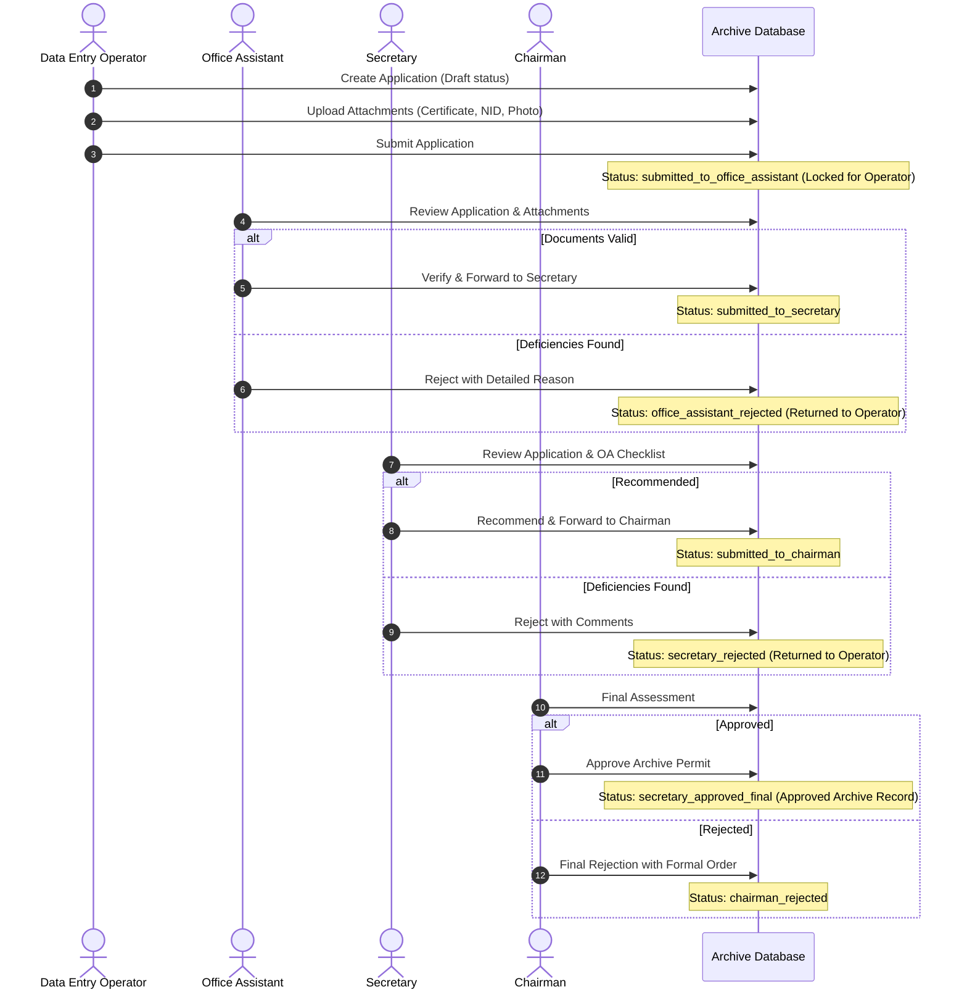

# 📘 OCEI Data Archive — Comprehensive User & Workflow Guide (v2.0)

> [!TIP]
> **🚀 Interactive In-App User Guide Available:**
> An interactive, searchable HTML version of this User Guide is embedded directly within the application at **[`http://localhost:8095/user-guide`](http://localhost:8095/user-guide)**. It includes live interactive tabs, high-resolution annotated ledger scan diagrams, role badges, and print-ready styles accessible from the sidebar and top navigation.

Welcome to the **OCEI Data Archive System User Guide**. This document provides an end-to-end, role-based visual walkthrough of the entire lifecycle for **Electrician**, **Supervisor**, and **Contractor** renew applications.

---

## 📑 Table of Contents

1. [👥 User Roles & Permission Matrix](#1-user-roles--permission-matrix)
2. [🔄 End-to-End Application Lifecycle (State Machine)](#2-end-to-end-application-lifecycle-state-machine)
3. [⚡ Electrician Application Workflow](#3-electrician-application-workflow)
4. [👔 Supervisor Application Workflow](#4-supervisor-application-workflow)
5. [🏢 Contractor Application Workflow (Organization Details)](#5-contractor-application-workflow-organization-details)
6. [📋 Role-by-Role Action Blueprints](#6-role-by-role-action-blueprints)
   - [6.1 Data Entry Operator](#61-data-entry-operator)
   - [6.2 Office Assistant (Verification)](#62-office-assistant-verification)
   - [6.3 Secretary (Recommendation)](#63-secretary-recommendation)
   - [6.4 Chairman (Approval / Rejection)](#64-chairman-approval--rejection)
   - [6.5 Super Admin (System & User Management)](#65-super-admin-system--user-management)
7. [📎 Document & Attachment Management](#7-document--attachment-management)
8. [📊 KPI Dashboards & Reports Export](#8-kpi-dashboards--reports-export)

---

## 1. 👥 User Roles & Permission Matrix

| Role | Dashboard | Create Draft | Edit Draft | Submit to OA | Verify & Forward | Recommend | Approve / Reject | Super Admin Override |
| :--- | :---: | :---: | :---: | :---: | :---: | :---: | :---: | :---: |
| **Data Entry Operator** | `/` | ✅ | ✅ (Draft/Rejected) | ✅ | ❌ | ❌ | ❌ | ❌ |
| **Office Assistant** | `/` | ❌ | ❌ | ❌ | ✅ | ❌ | ❌ | ❌ |
| **Secretary** | `/` | ❌ | ❌ | ❌ | ❌ | ✅ | ❌ | ❌ |
| **Chairman** | `/` | ❌ | ❌ | ❌ | ❌ | ❌ | ✅ | ❌ |
| **Super Admin** | `/` | ✅ | ✅ | ✅ | ✅ | ✅ | ✅ | ✅ (Full Power) |

---

## 2. 🔄 End-to-End Application Lifecycle (State Machine)

Every archive application traverses an automated 5-stage verification funnel before reaching final archival status:



---

## 3. ⚡ Electrician Application Workflow

### Core Fields
- **Personal Details**: Applicant Name (English & Bengali), Father's Name, Mother's Name, Date of Birth, NID Number, Mobile, Email.
- **Address**: Village, Post Office, Postcode, Upazilla, District, Division.
- **Education & Experience**: Degree, Subject, Passing Year, Result, Work Experience (Company, Designation, Duration).
- **Certificate Data**: Old Certificate Number, Approved Class Badge, Book Number, Issue Date, Expiry Date.

```
┌─────────────────────────────────────────────────────────────────────────────┐
│                       ELECTRICIAN APPLICATION REVIEW                        │
├─────────────────────────────────────────────────────────────────────────────┤
│  Tracking No: ELEC-2026-001          Status: [ SUBMITTED TO SECRETARY ]     │
│  Applicant:   MD. RAHIM UDDIN (মোঃ রহিম উদ্দিন)                              │
│  NID No:      19902692512345678      Mobile: 01711-000000                   │
│  Class:       [ Class A (3-Phase) ]  Book No: BK-8821                       │
├─────────────────────────────────────────────────────────────────────────────┤
│  [Tab 1: Basic Info] [Tab 2: Address] [Tab 3: Education] [Tab 4: Documents] │
└─────────────────────────────────────────────────────────────────────────────┘
```

---

## 4. 👔 Supervisor Application Workflow

### Core Fields
- **Personal & Professional**: Applicant Name (EN/BN), Father/Mother, NID, Mobile, Email.
- **Competency Certificate**: Supervisor Certificate Number, Scope of Competency, Education (Engineering Degree/Diploma).
- **Assigned Contractors**: Historical or current firms the supervisor is attached to.
- **Validity & Status**: Issue date, renewal history, current audit status.

---

## 5. 🏢 Contractor Application Workflow (Organization Details)

> [!IMPORTANT]
> Unlike Electrician and Supervisor records which represent individual persons, a **Contractor** record represents a **Business Firm / Organization**. 

### Distinct Contractor UI Labels & Data Fields:
1. **Organization Header**: The main entity column and form title display as **"Organization Name"** (or Business Name), pulling natively from `company_name_en` and `company_name_bn`.
2. **Approved Class**: Categorized as **Class A**, **Class B**, or **Class C** electrical contractor license.
3. **Trade License**: Registered trade license number and issuing municipal corporation.
4. **Assigned Certified Supervisor**: The registered electrical supervisor supervising the contractor's works.
5. **Testing Instruments (Mandatory Technical Audit)**:
   - **Earth Tester (ET)**: Serial No, Manufacturer Name, Country of Origin.
   - **Megger (MG)**: Insulation tester serial number and specifications.
   - **Clamp Meter (CM)**: Current measurement instrument details.

```
┌─────────────────────────────────────────────────────────────────────────────┐
│                        CONTRACTOR APPLICATION REVIEW                        │
├─────────────────────────────────────────────────────────────────────────────┤
│  Tracking No:        CONT-2026-0042                                         │
│  Organization Name:  KAZI INTERNATIONAL CONSTRUCTION LTD.                   │
│  Organization (BN):  কাজী ইন্টারন্যাশনাল কনস্ট্রাকশন লিঃ                         │
│  Approved Class:     [ CLASS A ]              Trade License: TR-DH-98421    │
├─────────────────────────────────────────────────────────────────────────────┤
│  TESTING INSTRUMENTS SPECIFICATIONS:                                        │
│  ├─ Earth Tester:  SN-ET-449102 (Megger Inc, United Kingdom)                │
│  ├─ Megger Tester: SN-MG-882190 (Kyoritsu, Japan)                           │
│  └─ Clamp Meter:   SN-CM-331005 (Fluke Corporation, USA)                    │
└─────────────────────────────────────────────────────────────────────────────┘
```

---

## 6. 📋 Role-by-Role Action Blueprints

### 6.1 Data Entry Operator
1. **Create Application**:
   - Navigate to **Permits $\to$ [Type] $\to$ Create Application** or use **Quick Create**.
   - Fill in mandatory fields across the tabbed form.
2. **Upload Documents**:
   - Upload scanned old certificates, NID cards, and photographs (`.pdf`, `.jpg`, `.png`).
3. **Save as Draft vs Final Submit**:
   - **Save Tab**: Saves progress; record remains in `draft` status (editable anytime).
   - **Submit**: Validates required attachments, locks the record against editing, and moves it into the Office Assistant review queue (`submitted_to_office_assistant`).
4. **Resubmitting Rejected Applications**:
   - If rejected by OA or Secretary, the record appears in your **Rejected** list with the reviewer's explanation notes.
   - Address the reviewer's feedback, update the attachments, and click **Re-Submit**.

---

### 6.2 Office Assistant (Verification)
1. **Queue Inspection**:
   - Access **Pending Verification** (`/ex-[type]/office-assistant/pending`).
2. **Verification Checklist**:
   - Verify authenticity of scanned old certificates against the physical book.
   - Confirm NID match and validity of testing instrument calibration reports.
3. **Actions**:
   - **Forward to Secretary**: Moves application to `submitted_to_secretary`.
   - **Reject**: Enter rejection reason; returns record to Operator with feedback.

---

### 6.3 Secretary (Recommendation)
1. **Queue Inspection**:
   - Access **Pending Recommendation** (`/ex-[type]/secretary/pending`).
2. **Scrutiny**:
   - Review Office Assistant verification notes and compliance checklist.
3. **Actions**:
   - **Recommend to Chairman**: Moves application to `submitted_to_chairman`.
   - **Reject**: Returns application to Data Entry Operator.

---

### 6.4 Chairman (Approval / Rejection)
1. **Final Decision**:
   - Access **Pending Approvals** (`/ex-[type]/chairman`).
2. **Actions**:
   - **Approve Archive Record**: Changes status to `secretary_approved_final`. Generates final archival registration number.
   - **Reject**: Rejects record with formal executive order.

---

### 6.5 Super Admin (System & User Management)
1. **User Management**: Add, deactivate, and reset passwords for Operators, Assistants, Secretaries, and Chairmen.
2. **Override & Audit Trail**: Full access to view complete change history (`record_histories`) for every single field alteration, including IP address, user agent, old value, and new value.

---

## 7. 📎 Document & Attachment Management

- **Storage Location**: Stored securely on the private disk (`storage/app/private/attachments/legacy_permits/...`).
- **Security & Authorization**: Protected by Laravel authorization policies. Public or unauthorized access is blocked with HTTP 403.
- **Inline Preview & Download**: Click the eye icon to preview PDF/images inline in the modal viewer without downloading, or click the download icon for binary retrieval.

---

## 8. 📊 KPI Dashboards & Reports Export

1. **Role Dashboards**:
   - Real-time stat counters: Total Drafts, Pending Verification, Pending Recommendation, Approved Archive, and Rejected.
   - Single-poller cross-tab notification synchronization keeps badges updated across all open browser tabs simultaneously.
2. **Reports & Exports**:
   - Filter by date range, district, class, or status.
   - Export preview on-screen or download official printable PDF reports.
