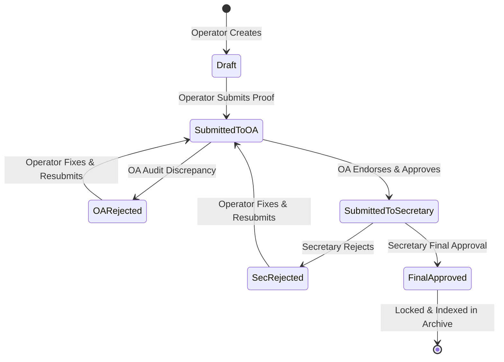

# 📘 OCEI Data Archive — Interactive User & Operations Manual (v2.0)

> [!TIP]
> **🚀 Live In-App Interactive Manual:**
> An interactive version of this manual is embedded directly within the application at **[`http://localhost:8095/user-guide`](http://localhost:8095/user-guide)**. It features real-time role filtering, interactive state machine simulators, zoomable scanned ledger specimens, and instant topic searching.

Welcome to the **OCEI Data Archive System Operations Manual**. This guide provides an end-to-end, visual, and practical walkthrough for all system roles (**Data Entry Operator**, **Office Assistant / Verifier**, **Secretary / Approver**, and **Chairman / Administrator**) covering the entire lifecycle of **Electrician**, **Supervisor**, and **Contractor** legacy records.

---

## 📑 Table of Contents

1. [🔄 Application Status Dictionary & The 5-Stage Lifecycle](#1--application-status-dictionary--the-5-stage-lifecycle)
2. [👨‍💻 Data Entry Operator (DEO) Complete Playbook](#2--data-entry-operator-deo-complete-playbook)
   - [2.1 Where to Find Your Entries & What Queues Mean](#21-where-to-find-your-entries--what-queues-mean)
   - [2.2 Quick Data Entry Mode (Split-Screen Scanner)](#22-quick-data-entry-mode-split-screen-scanner)
   - [2.3 5-Tab Comprehensive Archival Form](#23-5-tab-comprehensive-archival-form)
   - [2.4 Step-by-Step Entry by Category (Electrician, Supervisor, Contractor)](#24-step-by-step-entry-by-category)
   - [2.5 How to Handle and Fix Rejected Applications](#25-how-to-handle-and-fix-rejected-applications)
3. [👔 Office Assistant (Verification Officer) Playbook](#3--office-assistant-verification-officer-playbook)
   - [3.1 Accessing the Verification Queue](#31-accessing-the-verification-queue)
   - [3.2 Side-by-Side Review Screen](#32-side-by-side-review-screen)
   - [3.3 Approve vs. Reject (Mandatory Audit Reason)](#33-approve-vs-reject-mandatory-audit-reason)
   - [3.4 Bulk Verification & Batch Operations](#34-bulk-verification--batch-operations)
4. [📜 Secretary (Statutory Approver) Playbook](#4--secretary-statutory-approver-playbook)
   - [4.1 Executive Approval Queue](#41-executive-approval-queue)
   - [4.2 Permanent Archive Lock & Certificate Issuance](#42-permanent-archive-lock--certificate-issuance)
5. [🏛️ Chairman & Super Admin Playbook](#5-️-chairman--super-admin-playbook)
   - [5.1 Global Archival Search & Registry Lookup](#51-global-archival-search--registry-lookup)
   - [5.2 Analytical KPI Reports & Bottleneck Tracking](#52-analytical-kpi-reports--bottleneck-tracking)
   - [5.3 Administrative Overrides & Audit Log Restoration](#53-administrative-overrides--audit-log-restoration)
6. [📎 Annotated Historical Ledger Scans & Transcription Guidance](#6--annotated-historical-ledger-scans--transcription-guidance)

---

## 1. 🔄 Application Status Dictionary & The 5-Stage Lifecycle

Every licensing record moves through an automated state machine to ensure statutory authenticity and data integrity:

### Status Definitions Reference

| Status Code | Badge | Who Owns It | Is Editable? | Meaning & Operational Impact | Where Located in UI |
|:---|:---:|:---:|:---:|:---|:---|
| `draft` | Draft | Data Entry Operator | **Yes** | Saved locally in operator's private workspace. Not visible to verifiers. | `Applications List` |
| `submitted_to_office_assistant` | Submitted | Office Assistant | **No** (Locked) | Submitted with mandatory ledger scan. Queued in Office Assistant's verification list. | Operator: `Pending Approval` OA: `Pending Verification` |
| `office_assistant_rejected` | Rejected | Data Entry Operator | **Yes** (Unlocked) | Verification flagged an issue (e.g. blurry scan, name mismatch). Operator receives alert with remarks. | Operator: `My Rejected` |
| `submitted_to_secretary` | OA Verified | Secretary | **No** (Locked) | Office Assistant endorsed the application. Awaiting executive statutory approval. | Operator: `Pending Approval` Secretary: `Pending Approval` |
| `secretary_rejected` | Rejected | Data Entry Operator | **Yes** (Unlocked) | Secretary rejected with executive remarks. Sent back to operator for correction. | Operator: `My Rejected` |
| `secretary_approved_final` | Approved | Archive (System) | **No** (Permanent) | Formally approved and digitally locked into permanent archives. Searchable by Chairman & public inquiry. | Operator: `My Approved` Chairman: `Approved Records` |

---

## 2. 👨‍💻 Data Entry Operator (DEO) Complete Playbook

### 2.1 Where to Find Your Entries & What Queues Mean

In the application's left sidebar, every permit category (**Electrician**, **Supervisor**, **Contractor**) provides 4 dedicated operator queues:

1. **Applications List (`/ex-{type}/operator`):**
   - Displays **every application** entered under your account.
   - Shows current status, book number, applicant name, and last updated date.
   - Action buttons: `View`, `Edit` (if in draft or rejected status), `Delete` (drafts only).
2. **Pending Approval (`/ex-{type}/operator/pending`):**
   - Shows records you have submitted that are currently with the Office Assistant or Secretary.
   - Displays a status pill indicating which level is currently reviewing it.
3. **My Rejected (`/ex-{type}/operator/rejected`):**
   - **Crucial Workspace:** Displays any application returned by verifiers.
   - Clearly lists the verifier's **Rejection Reason** and feedback notes.
   - Click **Edit** to correct the record and resubmit.
4. **My Approved (`/ex-{type}/operator/approved`):**
   - Permanent archive view of applications that received final Secretary authorization.

---

### 2.2 Quick Data Entry Mode (Split-Screen Scanner)

**Best for high-volume entry directly from physical register ledgers.**

- **URL:** `/ex-{type}/operator/quick-create`
- **Interface Structure:**
  - **Left Pane (Interactive Scan Viewer):** Drag & drop or upload scanned book page. Tools available:
    - 🔍 `Zoom In (+)` and `Zoom Out (-)`: Inspect faint handwriting.
    - 🔄 `Rotate 90°`: Straighten scanned pages.
    - ✋ `Pan / Drag`: Move across large ledger pages.
  - **Right Pane (Rapid Transcription Form):**
    - Book Number (e.g. `BK-08`)
    - Old Certificate Number (e.g. `EL-10492` - Must be unique)
    - Class: `A`, `B`, `C`, or compound `ABC`
    - Applicant Full Name (Both English CAPITAL and Bengali script)
    - Father's Name, Mobile Number, NID
    - Issue Date and Expiry Date
- **Action Buttons:**
  - `Save as Draft`: Saves progress locally; stays in your private queue.
  - `Submit for Approval`: Validates fields and forwards directly to Office Assistant.

---

### 2.3 5-Tab Comprehensive Archival Form

**Used when capturing deep biographical, academic, and industrial history.**

- **Tab 1: Personal Information:** Certificate #, Book #, Class, Applicant Name (EN/BN), Father/Mother Name, NID, DOB, Mobile, Email.
- **Tab 2: Address Details:** Present & Permanent addresses (Village, Road, Post Office, Postcode, Upazilla, District, Division).
- **Tab 3: Academic Qualifications:** Degree Level (SSC, HSC, Diploma, BSc), Major/Subject, Board/University, Passing Year, Result/GPA.
- **Tab 4: Work & Industrial Experience:** Employer Company, Designation (e.g. Chief Plant Electrician), Joining/Relieving Dates, Total Job Duration.
- **Tab 5: Certificate & Attachments:**
  - Exam Center & Result Grade.
  - **Mandatory Attachment Dropzone:** Upload high-resolution ledger proof. *The system will block submission if no attachment is uploaded.*

---

### 2.4 Step-by-Step Entry by Category

#### ⚡ Electrician Permits
- Key emphasis on **Class Assignment** (`A` = High Voltage, `B` = Medium Voltage, `C` = Domestic Low Voltage, `ABC` = Unrestricted).
- Ensure candidate name spelling precisely matches Bangladesh Technical Education Board or Electrical Licensing Board transcripts.

#### 👔 Supervisor Certificates
- In **Tab 3 (Education)**, provide exact Diploma or BSc Electrical Engineering degree credentials.
- Validate Supervisor Registration ID.

#### 🏢 Contractor Licenses (Organizations)
- Transcribe **Company Name** in both English and Bengali.
- Enter **Trade License Number** and Issuing Authority (City Corporation / Pourashava / Union Parishad).
- Provide associated **Certified Supervisor Certificate Number** (must link to an approved supervisor).
- Input Head Office Address (BOA) and Branch Office Address (BRA).

---

### 2.5 How to Handle and Fix Rejected Applications

1. When a record is rejected, a notification bell icon appears in your top navbar.
2. Navigate to `My Rejected` under the relevant category.
3. Review the **Reject Reason** column (e.g., *"Father's name typo: entered 'Rahim' but ledger reads 'Karim'"*).
4. Click **Edit**. The form opens in editable mode.
5. Make the correction or upload an improved scan in Tab 5.
6. Click **Submit for Approval**. The status resets to `submitted_to_office_assistant`, and the verifier is notified.

---

## 3. 👔 Office Assistant (Verification Officer) Playbook

### 3.1 Accessing the Verification Queue
Navigate to `Verification &rarr; Pending Queue`. Applications are sorted chronologically by submission date. Use the header filters to filter by date range, class, or operator ID.

### 3.2 Side-by-Side Review Screen
Click **Review** on any pending record.
- **Left Side:** Displays the original historical ledger scan submitted by the operator.
- **Right Side:** Displays the operator's digital transcription.
- **Audit Checklist:**
  1. Does the certificate number match the book column?
  2. Is the candidate's name transcribed accurately in both English and Bengali?
  3. Are the class authorizations (`A`, `B`, `C`) correct?
  4. Is the original Board seal and signature visible on the scan?

### 3.3 Approve vs. Reject (Mandatory Audit Reason)
- **To Approve:** Click **"Approve & Forward to Secretary"**. Status changes to `submitted_to_secretary`.
- **To Reject:** Click **"Reject Application"**.
  - A modal appears requiring a mandatory explanation.
  - Input clear, actionable instructions (e.g., *"Missing educational certificate scan; please attach Diploma marksheet"*).
  - Status updates to `office_assistant_rejected`.

### 3.4 Bulk Verification & Batch Operations
To process large batches:
1. Review applications in the list.
2. Check the checkboxes on the left of verified rows.
3. Click the green **"Bulk Approve Selected"** button at the top of the table.

---

## 4. 📜 Secretary (Statutory Approver) Playbook

### 4.1 Executive Approval Queue
Navigate to `Approval (Secretary) &rarr; Pending`. The Secretary performs the final statutory audit of records endorsed by Office Assistants.

### 4.2 Permanent Archive Lock & Certificate Issuance
1. Open the application review page.
2. Inspect verification notes and attachment proofs.
3. Click **"Final Approve"**:
   - The application is permanently sealed from all future edits.
   - Status updates to `secretary_approved_final`.
   - Approval timestamp and Secretary user signature are immutably logged in `RecordHistory`.
   - The record becomes searchable in the Chairman's inquiry portal and public verification services.

---

## 5. 🏛️ Chairman & Super Admin Playbook

### 5.1 Global Archival Search & Registry Lookup
- Navigate to `Approved Records` under Electrician, Supervisor, or Contractor.
- Search across millions of records with sub-millisecond response times using indexed fields:
  - By Book Number (e.g., `BK-12`)
  - By Certificate Number (e.g., `EL-48291`)
  - By Candidate Name or Company Name
  - By Trade License Number or Class

### 5.2 Analytical KPI Reports & Bottleneck Tracking
- **`/reports/kpi`:** Overview of total digitized volume, approval vs rejection ratios, and average turnaround time.
- **`/reports/operator`:** Digitization performance per operator (daily, weekly, monthly).
- **`/reports/office-assistant`:** Verification backlog and processing speeds.

### 5.3 Administrative Overrides & Audit Log Restoration
- Super Admins can restore soft-deleted applications via the administrative portal.
- Inspect the complete chronological timeline of every change, review, and status shift in `RecordHistory`.

---

## 6. 📎 Annotated Historical Ledger Scans & Transcription Guidance

When transcribing physical ledger books, operators and verifiers should refer to these standard specimen annotations:

### Specimen 1: Electrician Historical Register Page
- **Hotspot [1] Top Right:** Ledger Book Number (e.g., `BK-12`).
- **Hotspot [2] Column 1:** Old Certificate Number (e.g., `EL-48291`). Must be entered exactly without spaces.
- **Hotspot [3] Column 2 & 3:** Candidate Name and Father's Name in English and Bengali.
- **Hotspot [4] Column 5:** Permit Class (Letters `A`, `B`, `C`, or `ABC`).
- **Hotspot [5] Bottom:** Board Secretary seal and examiner signatures.

### Specimen 2: Supervisor Historical Register Page
- **Hotspot [A] Header:** Supervisor Registration Tracking Code.
- **Hotspot [B] Qualification Column:** Academic Degree title (Diploma in Electrical Engineering, etc.).
- **Hotspot [C] Dates Column:** Statutory Issue Date and Expiry Date.
- **Hotspot [D] Seal:** Official Licensing Board seal.
